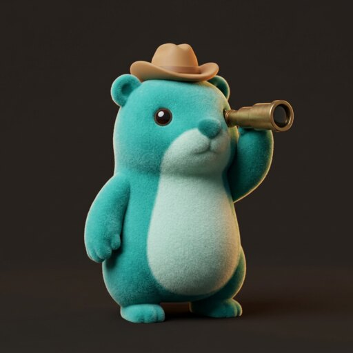
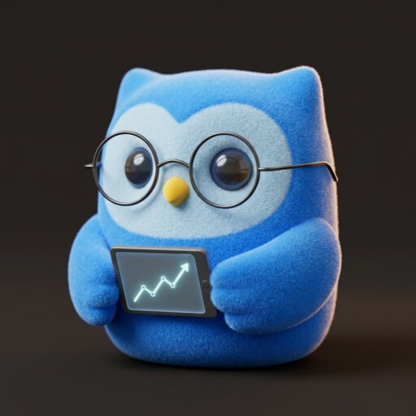
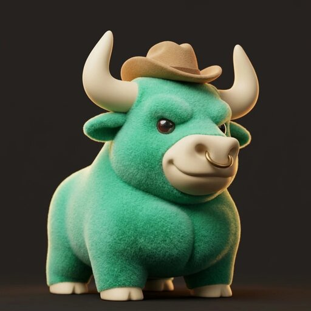
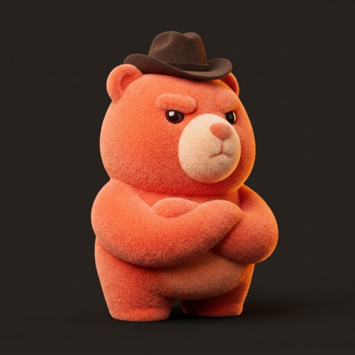
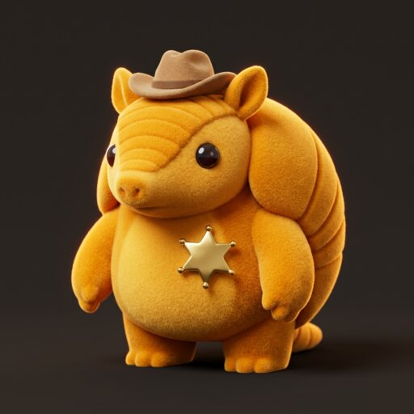
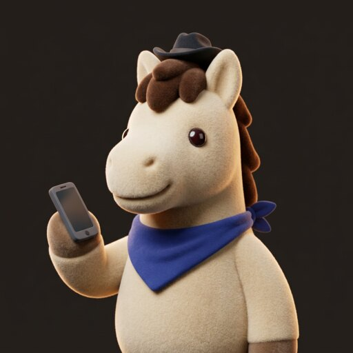
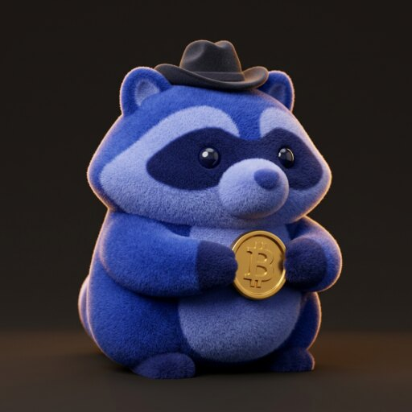
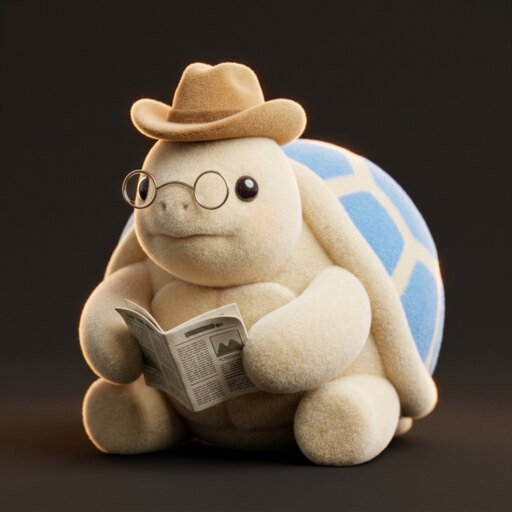

# Characters: the desk's employees

The bot employees on [/desk](https://www.cowboy.money/desk) are 3D animal characters that
look like collectible vinyl toys with a short, velvety flocked finish. Every
new character should look like it came off the same shelf. This page is the
recipe: the style rules, the exact prompt, the settings, and the eight
prompts that made the current cast.

The renders live in [`characters/`](characters/) (512×512 JPEG);
their names, roles and colors are in `brand.json` (and cowboy-agent's `app/desk/_lib/hires.ts`).

| | | | |
| --- | --- | --- | --- |
|  Scout |  Chartist |  Bull |  Bear |
|  Risk |  Trader |  Crypto watcher |  Macro reader |

## The rules

1. **An animal, not a blob.** Each employee is a different species with its
   own silhouette, picked for its job: a prairie dog that keeps lookout, an
   owl that reads charts, a bull, a bear, an armadillo in armor for risk, a
   horse that carries the message. Never a generic rounded mascot.
2. **Velvet vinyl, not plush.** A matte, slightly fuzzy flocked surface on a
   chunky, simple toy shape. Not long fur, not a soft stuffed toy, and no
   pink blush cheeks. (A cream, round, blushing plush looks like another
   company's mascot; we tried it and dropped it.)
3. **One brand color for the body.** The animal is colored in its role's
   High Noon or brand color ([colors.md](colors.md)), with a lighter belly,
   face or muzzle in the same family. Cream is allowed for a character whose
   role is cream on the page.
4. **One western touch and one prop.** Every employee wears a small cowboy
   hat (tan, dark brown or black). Each holds or wears one prop that says
   its job: a spyglass, a tablet with a chart, a nose ring, crossed arms, a
   sheriff's star, a phone, a coin, a newspaper. One prop, not a scene.
5. **Glossy dark eyes with one white highlight.** That is the whole face
   language; expression comes from brows, mouth and pose.
6. **The same stage every time.** Front three-quarter view, head and torso
   centered and filling the square, soft studio light with a warm rim
   light, a gentle shadow, on the flat dark ground (`#252322`, the page's
   `brand-ground`), so a render drops onto the page with no visible edge.
7. **No text** in the image, ever.

## The prompt

Generated with **Nano Banana 2.1** (Google) through Higgsfield, 1:1,
resolution 1k, no reference image. Keep the style block word for word and
change only the subject line.

```text
3D designer vinyl toy character with a soft velvety flocked finish (short,
slightly fuzzy, matte), stylized and chunky with simple geometric
proportions. {SUBJECT} Front three-quarter view, head and torso centered,
filling the frame. Soft studio light with a warm rim light, gentle shadow.
Solid flat dark warm charcoal background #252322. Collectible toy
photography, crisp, no blush, no text.
```

`{SUBJECT}` is one or two sentences in this order: **the animal and its
job**, **its colors** (body in the role's hex, plus a lighter belly, face or
muzzle), **eyes** ("glossy dark eyes with a white highlight"),
**expression**, **the prop**, **the hat**.

### The cast's subject lines

| Employee | Color | `{SUBJECT}` |
| --- | --- | --- |
| Scout | aqua `#38C6C0` | A prairie dog scout standing upright, fur in teal #38C6C0 with a lighter belly, glossy dark round eyes with a small white highlight, alert curious expression, holding a small brass spyglass to its eye, wearing a tiny tan cowboy hat. |
| Chartist | sky `#4F8CFF` | A small owl chartist, feathers in bright blue #4F8CFF with a lighter face disc, big glossy dark round eyes with a white highlight behind thin round wire glasses, studious focused expression, holding a tiny tablet showing a rising line chart. |
| Bull | mint `#46D98A` | A bull, fur in mint green #46D98A, cream horns curving upward, a cream muzzle with a small brass nose ring, glossy dark eyes with a white highlight, confident grin, chest puffed out, wearing a tiny tan cowboy hat tipped back. |
| Bear | coral `#FF6A4D` | A grizzly bear, fur in coral orange #FF6A4D with a lighter muzzle, glossy dark eyes with a white highlight, one eyebrow raised in a skeptical look, arms crossed, wearing a tiny dark brown cowboy hat pulled low. |
| Risk | marigold `#FFB020` | An armadillo sheriff, banded shell and fur in golden marigold #FFB020, glossy dark eyes with a white highlight, calm serious expression, a shiny gold six-point sheriff star badge on its chest, wearing a tiny tan cowboy hat. |
| Trader | cream `#EFE9DF` | A horse trader, coat in warm cream #EFE9DF with a dark brown mane, glossy dark eyes with a white highlight, friendly easy smile, a cobalt blue bandana #2B3F91 around its neck, holding up a small smartphone in one hoof, wearing a tiny dark cowboy hat. |
| Crypto watcher | cobalt `#2B3F91` / `#6F86FF` | A raccoon crypto watcher, fur in cobalt blue #2B3F91 and periwinkle #6F86FF with a darker eye mask, glossy dark eyes with a white highlight, alert nocturnal expression, holding a shiny gold coin with a simple Bitcoin B symbol, wearing a tiny dark cowboy hat. |
| Macro reader | cream + sky | A tortoise macro reader, shell and skin in warm cream #EFE9DF with a sky blue #4F8CFF patterned shell, glossy dark eyes with a white highlight behind small round spectacles, calm thoughtful expression, holding a folded newspaper, wearing a tiny tan cowboy hat. |

### A new character

Pick an animal whose nature matches the job (and that isn't already on the
desk), give it the role's color, one prop and a hat, and fill in the
subject line. For example, an options clerk:

```text
A fox options clerk, fur in marigold #FFB020 with a cream chest and tail
tip, glossy dark eyes with a white highlight, sharp attentive expression,
holding a small calendar with one date circled, wearing a tiny black
cowboy hat.
```

Generate two or three and keep the one whose pose and framing match the
cast: compare it side by side with the eight above before using it.

## Finishing a render

1. Check it against the rules: species reads at 40px, one prop, hat on, no
   blush, no text, background flat and dark.
2. Resize to 512×512 and save as a JPEG at about 86% quality with metadata
   stripped (each file ends up 25 to 35 KB), e.g.
   `convert in.png -resize 512x512 -strip -quality 86 characters/<id>.jpg`.
3. Name the file after the employee's id in `DESK_HIRES` (`lib/waitlist.ts`)
   and add its look in `brand.json` (and cowboy-agent's `app/desk/_lib/hires.ts`).

The page crops the renders to circles and rounded squares with
`object-position: 50% 28%`, which keeps the face in frame; a subject framed
lower than the cast will lose its head in the small avatars.

## What didn't work

- **Flat vector badges** (Recraft V4.1, vector mode): clean, but icon-like
  and off-palette backgrounds; read as clip art next to the page.
- **Cream plush blobs** (round, long fur, blush cheeks): too close to
  another brand's mascot, and every character looked the same.
